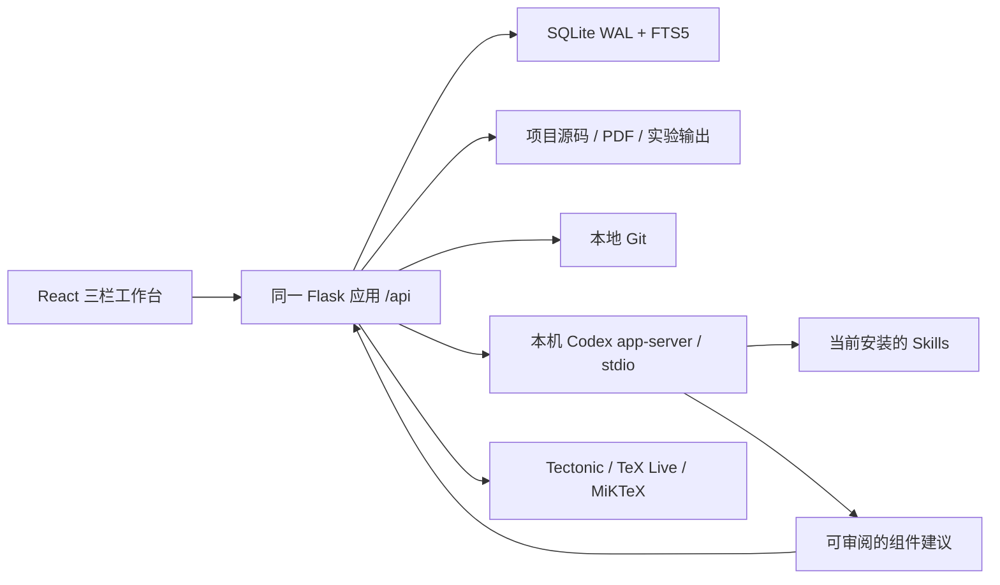

# EasyRef 本地科研工作台

## 代码审计（2026-10-29）

原工程是 React/Vite + Flask，`backend/app/routes.py` 与 `api_routes/` 提供文献、文件、Agent 等接口；`db.py` 使用 psycopg，PDF 上传使用 Supabase Storage。原 Skills 目录只是静态 catalog。原生 PDF.js、Markdown 编辑器、三栏布局和工具函数可以复用。未发现自动化测试；迁移是启动时执行 PostgreSQL ALTER。现有 CCF CSV 为 2022 版。

工作开始时仓库存在大量已暂存/未暂存和未跟踪改动。没有 reset、checkout、清空暂存区或提交这些改动。新增本地服务作为同一个 Flask 应用的默认模式，原服务仅保留给旧部署兼容和数据迁移；React 仍使用原工程、入口和 PDF.js 组件。

本机已验证 `codex-cli 0.155.1`，`codex login status` 显示 ChatGPT 登录。已执行 `codex app-server generate-json-schema --out backend/data/codex-schema`，适配器按安装版本生成的 Schema 验证请求。没有读取登录凭据。

实施依赖：SQLite/迁移/文件与 Git → CCF/FTS5/导入 → Codex/Skills → 共享项目五工作区 → 实验/论文/证据 → Review/投稿 → 自动化和实机验证。

## 1. 实际修改的文件与模块

以下为本次本地工作台改造范围；工作开始时已有的 `api_routes/`、`routes.py`、`profile/` 等用户改动不是本次新增成果。

| 文件或目录 | 实际职责 |
|---|---|
| `backend/app/__init__.py` | 同一个 Flask 应用默认加载本地服务；旧 Supabase 模式延迟加载 |
| `backend/app/local_api.py` | 本地 HTTP API、SSE、文件服务、快照和导出 |
| `local_store.py`、`migrations/001_local.sql`、`002_outline_history.sql` | SQLite、FTS5、事务、版本与证据 |
| `local_literature.py`、`backend/registry/ccf-2026.json` | CCF Registry、DBLP 在线/流式导入、检索、BibTeX |
| `local_codex.py`、`local_proposals.py` | 当前 CLI Schema 适配、真实会话、审批、Skills 顺序执行、组件修改建议 |
| `local_experiments.py` | 实际进程、配置、日志、指标、取消和 Run 比较 |
| `local_paper.py`、`local_latex.py` | LaTeX 工程、段落锚点、大纲历史、本机编译器发现和调用 |
| `local_review.py` | 有轮次/时间限制的真实审稿角色、结构化 Issues |
| `local_git.py`、`local_versions.py` | Checkpoint、Git Diff、文件回退和分支结构化状态恢复 |
| `backend/run_local.py`、`requirements-local.txt` | 无 Supabase 的启动入口和依赖 |
| `backend/scripts/` | Registry 提取、可选旧数据迁移、完整备份恢复、真实 Codex/LaTeX 验收脚本 |
| `frontend/src/components/research/` | 共用项目上下文的五个工作区、Assistant、三栏样式 |
| `frontend/src/main.jsx`、`components/PdfViewer.jsx` | 默认工作台入口、复用原 PDF 阅读器；PDF.js 升至 4.10.38 |
| `frontend/package*.json`、`vite.config.js`、`index.html` | 依赖、构建、环回代理、EasyRef 标题 |
| `backend/tests/`、`frontend/tests/`、`playwright.config.js` | 后端集成/回归测试与真实浏览器测试 |
| `scripts/start-local.ps1`、`.env.example`、`.gitignore`、README | 启动、配置和数据保护说明 |

沿用原 React/Vite 与 Flask 工程，没有新增第二个独立前端或后端服务。默认页面改为五工作区；原有 PDF.js 阅读器继续复用。旧云端页面和 API 保留在显式兼容模式，尚未把旧页面的每一项功能重新接入本地数据。

## 2. 最终架构与数据位置



默认数据目录为仓库根目录 `.easyref/`，可用 `--data-dir` 或进程环境变量 `EASYREF_DATA_DIR` 更改。

```text
.easyref/
  easyref.sqlite3                 # 共享数据库；附带 WAL/SHM 文件
  projects/<project-id>/          # 新项目的独立 Git 根目录
  pdfs/<sha256>.pdf               # 用户主动关联的文献 PDF
  snapshots/<submission-id>.zip   # 不可变投稿快照
  codex-schema/                  # 当前 CLI 版本生成的 Schema
  backups/                       # SQLite online backup
  exports/                       # 项目导出包

<research-project>/
  research/<kind>/<id>.json       # SQLite 组件的 Git/Codex 可读导出
  research/state.json            # 当前分支组件、Outline、Evidence 状态
  paper/                         # 完整 .tex/.bib/图片/样式工程
  .easyref/runs/<run-id>/         # 命令日志、配置、入口脚本副本、指标
  .easyref/proposals/             # Codex 结构化修改建议
  .easyref/accepted-proposals/    # 采纳前的建议原文
  .easyref/latex/                 # 编译结果、日志与 SyncTeX
```

导入已有项目时使用其 Git 根目录，不移动原文件。SQLite 是结构化组件的权威来源，`.tex` 是论文正文权威来源。Git 管理研究源码及结构化状态导出；大型权重、PDF、依赖、运行缓存不自动纳入 Checkpoint。

这是单用户、单进程的本机应用。服务仅绑定 `127.0.0.1`；不要用多进程 Flask/Gunicorn 启动同一数据目录，因为进程管理、审批和导入工作者在内存中协调。

## 3. 数据库与迁移

`Store` 每次连接启用外键与忙等待，数据库启用 WAL。迁移逐文件事务执行，并记录文件 SHA256；已执行迁移被修改会报错，不会静默重建数据库。

| 表组 | 含义 |
|---|---|
| `projects` | 稳定项目 ID、根路径、写作规则等配置 |
| `venues` / `venue_aliases` / `venue_dblp_mappings` | CCF 名称、等级、学科、类型、来源与 DBLP Stream 映射 |
| `papers` / `papers_fts` / `paper_library_entries` / `annotations` | 文献、全文检索索引、项目收藏、页码/引文/笔记 |
| `components` / `revisions` / `component_links` | Idea、Blueprint、模块、Claim、段落、章节、图、表、Venue Profile、任务的统一稳定身份与修订 |
| `experiments` / `experiment_artifacts` | Run、父 Run、代码/配置/环境/指标与文件哈希 |
| `evidence_links` | Claim 到实际文献、实验或组件的定位与版本哈希 |
| `paragraph_outlines` / `outline_versions` / `paragraph_evolution` / `paper_versions` | 稳定段落大纲、大纲历史、拆合复制关系、源码版本 |
| `agent_sessions` / `agent_messages` / `skill_runs` | 真实会话、公开事件、Skill 执行次序与结果 |
| `reviews` / `review_issues` | 有界审稿任务、问题、定位、验证要求与状态 |
| `submission_attempts` / `submission_events` | 不可变投稿快照与后续追加的结果/修订事件 |
| `import_jobs` / `schema_migrations` | 导入进度、错误、断点、数据库迁移记录 |

`001_local.sql` 建立核心表；`002_outline_history.sql` 增加大纲修订历史，并区分 `prepared` 与 `submitted` 快照；`003_literature_browse_indexes.sql` 为大规模文献库增加按来源/年份/标题检索排序的索引。测试覆盖从仅有 001 的数据库升级，保留原项目数据。投稿记录有数据库触发器拒绝 UPDATE/DELETE；后续状态通过事件追加。

可选旧数据迁移：

```powershell
# 在当前进程中配置旧实例的 SUPABASE_URL 和访问凭据后执行；程序不打印凭据。
.\.venv\Scripts\python.exe backend/scripts/migrate_supabase_local.py --data-dir D:/EasyRefData --limit 1000
```

该脚本仅只读获取旧 `papers` 元数据，写入个人参考资料。不会向旧服务写入或删除。旧 Storage PDF、账号、文件夹及历史 Agent 数据尚未自动迁移；本次未连接实际 Supabase 实例验收。

## 4. 本地 Codex 接入

实机版本为 `codex-cli 0.155.1`，通过现有 ChatGPT 登录运行。EasyRef 调用公开的 `--version` 和 `login status` 检测，不读取 `auth.json`，不要求独立 API Key，也不修改全局模型配置。

适配器按 CLI 版本生成 `app-server generate-json-schema`，在发送请求前以生成的 JSON Schema 校验参数。通过 stdio JSON-RPC 调用 `initialize`、`thread/start`、`thread/resume`、`turn/start`、`turn/steer`、`turn/interrupt` 和 `skills/list`。Windows npm shim 解析为 Node + Codex 入口，不通过拼接 Shell 命令执行。

公开 Agent 输出、命令/文件变更事件、失败和审批请求存入数据库，由 SSE 推送并通过状态轮询补偿断连。过滤 reasoning 事件、reasoning items 和嵌套的 reasoning 内容。需要用户批准的操作展示真实请求并返回经 Schema 校验的答复；不自动批准。未知服务器请求明确拒绝并记录。

普通研究会话使用 workspace-write，Review 使用 read-only。用户可以在运行中插入意见、中断、切换和恢复会话。重启后运行中的会话标为 disconnected，保留历史；恢复不表示旧进程仍在继续执行。CLI 版本缺少接口、网络中断和超时会显示实际错误。

## 5. Skills 与建议采纳

通过当前 app-server 的 `skills/list` 发现项目和用户可用 Skills，显示名称、说明、路径、启用状态及执行记录。阶段标签由名称/说明启发式归类；输入输出提示目前是通用提示，不是对任意 Skill 规范的完整结构化解析。

勾选顺序决定执行顺序。多个 Skill 使用同一研究 thread 的独立 turns 串行执行，上一步完成后才开始下一步；失败、中断、断连会停止后续步骤。每步分别保存输入上下文、状态和实际公开输出。未逐个测试用户安装的所有 Skills。

结构化组件的推荐写入方式：

```json
{
  "component_id": "要修改的组件 ID；新组件省略",
  "expected_revision": "当前修订 ID；新组件省略",
  "kind": "idea",
  "name": "研究构想名称",
  "data": {"hypothesis": "可核验的研究假设"},
  "purpose": "本次修改原因"
}
```

Codex 将建议写到项目 `.easyref/proposals/*.json`。右栏“检查组件修改建议”展示实际 Diff；点击采纳时重新检查文件 SHA256 和基础修订，创建新修订并保存建议原文。直接改动 `research/` 组件导出也会被检测；Checkpoint 不会静默覆盖它。论文正文则通过 `.tex` 锚点与 Paper 版本管理同步，段落 JSON 不作为正文写入入口。

## 6. 五个工作区与 CCF 数据

| 工作区 | 当前可用功能 |
|---|---|
| Literature | 本地 FTS5、等级/类型/学科/年份/作者/Venue 筛选与排序；DBLP 在线查询和 XML 导入；项目收藏、个人资料、BibTeX、PDF 阅读、页码/引文笔记；选中文献带入 Assistant |
| Idea | 九个结构化字段、多 Idea、修订 Diff/回退、带来源修订转换为初始 Blueprint |
| Experiment | 固定设计锚点、模块/连接/代码路径、架构 SVG、历史修订、实际脚本执行、日志、指标、Run 对比 |
| Paper | .tex/ZIP 工程、目录、连续源码阅读、局部/全文编辑、段落大纲蓝条、历史 Diff/回退、实际 PDF 编译与预览 |
| Review | Claim/Evidence、六类角色、轮次/预算、真实 Issues、定位、用户介入、后续任务、Venue Profile、投稿分支/快照 |

默认 Registry 依据 [CCF 2026 第七版正式发布](https://www.ccf.org.cn/Academic_Evaluation/By_category/2026-03-31/870181.shtml)，PDF 取自 [丽水学院科研处转发页](https://kyc.lsu.edu.cn/2026/0518/c1772a367789/page.htm)，提取脚本为 `backend/scripts/build_ccf_registry.py`。Registry 保存来源、核验日期和 PDF SHA256。

实际提取 **681 条目录记录、10 个学科**；669 条含稳定 Stream，跨学科重复项折叠后为 665 个唯一映射。PDF 中 AsiaCCS 的错误指向已按 [DBLP AsiaCCS](https://dblp.org/db/conf/asiaccs/index.html) 修正。12 条暂未建立可靠 Stream 的目录项保留为未映射，自动导入不猜测归类：JCC、HCC、HotSec、JASA、VRST、NCMMSC、JSLHR、JATS、Cognition、BCRA、IET Intelligent Transport Systems、EITEE（原 FITEE）。

分类优先使用显式 Stream，其次使用稳定 DBLP key 前缀。明确的 Workshop、Companion、Findings、Adjunct、Demo 等附属出版物排除；如果正式目录条目本身是 Workshop 则按其独立 Stream 处理。无法确定文章类型时标为 `unknown`，不能把 Venue 等级等同于长文/正式论文认定。手工非 CCF 文献单独保存在 `personal` 来源中。

XML/.gz 使用 lxml 流式解析和分批事务，清理已处理节点，不把完整 DBLP 存进数据库。原有 `dblp/dblp.xml` 保持不变，也没有另行下载完整快照。导入提供进度、暂停、重启恢复、去重/upsert、错误日志和 FTS 触发器。恢复会从头流式回放并跳过已处理记录，不是 XML 字节级 seek。暂未实现官方差异补丁和删除记录同步。

本次在线 API 返回了非 JSON 内容，网络模式没有通过实机成功验收；代码会明确提示并允许改用本地 XML。没有把该失败伪装成在线缓存成功。

## 7. Blueprint、实验与对比

Blueprint 的权威结构是可版本化 JSON/文本，模块有稳定 ID、说明、代码路径和连接。每次保存生成不可变修订，Run 引用具体修订；Idea 来源和设计决策保持可查。当前架构图支持点选，暂不支持拖动节点或图形化连线。

Run 记录命令 argv、工作目录、Parent/Baseline、Git commit/原始 Diff、Blueprint revision、dataset、split、seed、hyperparameters、评估协议、修改目的、环境与测试数据标记。执行前再次捕获 Git 状态；登记后入口脚本发生变化会拒绝执行。保存入口脚本副本及 SHA256。

直接运行支持 Python、Node、Rscript 的项目内脚本，不接受 Shell 字符串或 `-c/-e`。按钮明确显示并授权命令；这是本机账户的进程执行，不是独立 OS 沙箱。需要 Codex 授权/沙箱的任务应在 Assistant 执行。脚本可读取 `EASYREF_CONFIG`、`EASYREF_RUN_ID`、`EASYREF_METRICS_PATH`。完成时仅解析本轮实际更新的有限数值 JSON 指标，不存在指标就显示“无指标”。失败、取消、重试均保留 Run。

任意两 Run 比较配置、Blueprint、原始 Git Diff、各自工作区 Diff和指标差值。Dataset/Split/Protocol/Seed/未提交代码变化会产生可比性提示；不自动把数值增减解释为架构改进。当前保留建议为人工判断，不会生成没有证据的性能因果结论。直接运行不冻结全部依赖、数据文件或运行中被其他进程修改的代码，不能等同于完整可复现容器。

## 8. Paper 与段落锚点

以不影响排版的 `% easyref:paragraph:<uuid>` 注释标识段落，不依赖行号。正文连续显示，左侧细蓝条悬停给出写作意图，点击右栏编辑 Section/Purpose/Main Claim/Evidence/Connection/References/Experiments，可置顶和锁定。修改正文不会改写 Outline，而会标记待核查；锁定 Outline 需要显式解锁。

局部编辑仅替换选中段落；全文保存使用原文 SHA256 防止旧编辑覆盖新内容。删除已有 ID 的结构性保存会列出受影响 ID 并拒绝；`paper/evolve` API 提供拆分/合并/复制及 lineage。移动可保留原注释 ID。现阶段拆合操作尚未提供专用可视化按钮。

导入 ZIP 保留子文件、图片、`.bib`、样式与类文件；已有工程需要点击建立段落锚点。当前全文阅读按选中的 `.tex` 文件连续呈现，不会把任意宏或多个 `\\input` 展开成跨文件富文本。编译时保留完整工程关系。

**编译器检测已修正**：不只查 PATH，支持 `EASYREF_LATEX_BIN`、`CODEX_TECTONIC_PATH`、常见 TeX Live/MiKTeX 路径以及 Codex 安装包/本地缓存。必须实际运行 `--version` 成功才判定可用。WindowsApps 中发现但无权启动的版本保留诊断，并继续查找可运行版本。本机实际使用 **Tectonic 0.16.9** 成功编译多文件工程；之前“本机没有编译器”的判断是漏检，已纠正。

Tectonic 使用 `--untrusted`、日志和 SyncTeX；传统引擎关闭 shell escape。输出只有本次成功生成的 PDF 才会显示。Tectonic 缺失宏包时可能访问其正常资源源；未缓存资源不保证离线可编译。传统引擎目前是单次调用，复杂 BibTeX/Biber/多轮工具链仍需 latexmk 等外部流程。

已生成真实 SyncTeX 文件，但**尚未实现可靠的段落到 PDF 坐标映射和双向跳转**；PDF 不显示猜测坐标的蓝条。

## 9. Evidence、Review 与用户介入

Claim 状态区分 `Unsupported`、`Needs Review`、`Verified`。Verified 必须存在可定位证据，证据哈希仍匹配，且用户填写核验说明。模型输出不能自行把 Claim 标为 Verified。指标更正保存 before/after/reason 文件，自动标记相关 Claim、段落/图表组件和 Review Issue 待核查。

Review 支持 Novelty、Methodology、Experiment、Reproducibility、Writing、Author/Rebuttal 六个角色，每个角色由真实本机 Codex session 执行。默认沿用同一模型配置，因此界面明确说明是不同角色，不是独立模型交叉验证。每轮按选择的角色顺序执行，向后续角色提供已有问题；轮数限 1–5，时间预算 30–3600 秒，用户可中断。

只有实际完成的结构化输出才登记 Issue：严重性、组件/实验 ID、问题、证据、修复建议、验证要求和状态。无可靠定位允许空 ID，不伪造定位。点击会话可查看真实讨论并插入意见，问题可转为实验/写作任务，再由 Assistant 带入处理。只读审稿不会直接覆盖源码，解决或拒绝问题需要用户依据。

当前并非自动闭环的多模型审稿平台：预算是墙钟时间而不是 token/费用硬预算；角色调用启动和网络超时可能略超墙钟预算；已完成 Issue 不会因后续角色表态而自动关闭。文献问答、章节生成和证据审查可经选中上下文与真实 Skills 发起，但尚无覆盖每个写作阶段的专用向导。

## 10. Git、投稿、转投与备份

新项目使用 `research/main`。Checkpoint 只收集允许的文本源码，使用临时 Git index，并拒绝消费用户已有暂存修改。文件回退先备份当前文件；组件回退创建新 revision。分支切换要求工作区干净且无活跃实验/Agent，恢复该分支的组件、Outline、Links 和 Evidence 状态，不把其他分支组件当成当前内容。

推荐流程：保存设计/正文 → 保存 Checkpoint → Review 中创建 `submission/<venue>` 快照 → 切换投稿分支修改 → 再次 Checkpoint。被拒或修订时追加 Reject/Major Revision/Rebuttal 等事件，创建带 Parent Submission 的 `revision/` 或下一投稿分支，旧 ZIP 与哈希不变。Venue Profile 保存模板、页数、图表、引用、匿名要求、核验来源和日期；这些规则仍需人工核实，不自动抓取或声称完成格式转换。

快照包含已提交源码、当前分支组件/大纲、所选实验记录和可选 PDF。勾选“已实际提交”必须提供当时 PDF并保存其哈希；普通准备快照不会冒充真实投稿。系统记录投稿，不代为向会议/期刊发送。

侧栏“备份”导出 SQLite 数据库；**它不包含项目文件和 PDF**。Review 的“导出项目”提供当前项目 JSON/源码/相关 PDF/投稿快照，不附带其他项目的整个共享数据库，也不是完整恢复包。

完整离线备份/恢复（建议停止任务和文件编辑后执行）：

```powershell
.\.venv\Scripts\python.exe backend/scripts/local_data.py export .easyref D:/EasyRef-backup.zip
.\.venv\Scripts\python.exe backend/scripts/local_data.py restore D:/EasyRef-backup.zip D:/EasyRef-Restored
.\.venv\Scripts\python.exe backend/run_local.py --data-dir D:/EasyRef-Restored
```

完整备份包括 SQLite、所有项目文件及独立 Git 历史、PDF、快照；恢复仅允许空目录，修正路径并检查数据库完整性。不会覆盖已有数据。使用外部 Git worktree 的项目目前拒绝完整备份，避免遗漏其外部 Git 历史；应另行完整克隆/备份。项目内容与 SQLite 不是跨进程原子快照，因此备份期间应停止编辑。

## 11. 启动与开发

依赖：Python 3.11+、Node.js/npm、Git；AI 功能另需本机 Codex CLI 登录。无 Supabase、PostgreSQL、Redis、Elasticsearch 要求。

```powershell
python -m venv .venv
.\.venv\Scripts\python.exe -m pip install -r backend/requirements-local.txt
npm --prefix frontend ci
npm --prefix frontend run build
.\.venv\Scripts\python.exe backend/run_local.py
```

访问 `http://127.0.0.1:5000`。已有依赖可直接执行最后一条。完整脚本：

```powershell
powershell -ExecutionPolicy Bypass -File scripts/start-local.ps1 -Port 5000 -DataDir D:/EasyRefData
# 已安装依赖时
powershell -ExecutionPolicy Bypass -File scripts/start-local.ps1 -SkipInstall
```

开发前端：`npm --prefix frontend run dev`，访问 `127.0.0.1:5180`，代理后端 5000。默认本地启动不会为了读取旧 `.env` 而导入云服务。自定义配置通过进程环境变量传入，例如 `$env:EASYREF_LATEX_BIN='C:/path/to/tectonic.exe'`；应用没有自动加载 `.env`。

兼容旧部署需显式 `EASYREF_STORAGE=supabase`、构建时 `VITE_EASYREF_LEGACY=true` 并使用旧依赖。不要把旧模式的部署说明当成本地模式前置条件。

## 12. 实际验收与复跑

本次完成真实后端测试、Chrome 浏览器测试、CLI 调用和文件检查；没有把 mocked transport 测试当成真实模型执行。

最终自动化结果：**29 passed（后端，26.68 秒）**；**1 passed（浏览器端到端，9.2 秒）**。浏览器流程包含从 Paper 按钮实际编译、PDF canvas 与文本层验证。

| 验收项 | 证据 |
|---|---|
| 无 Supabase 启动、WAL/外键/迁移/升级/备份 | `backend/tests/test_local_workbench.py`、`test_integrity_edges.py` |
| CCF A/B/C、去重、个人库隔离、FTS、暂停/恢复、XXE | 同上；另从原 5.24 GB 快照扫描 110,535 条以选出 A/B/C 各 2 条真实记录，6 条导入成功 |
| Idea → Blueprint → 修改模块 → Diff/回退 | 后端测试 + 浏览器真实操作 |
| 两个真实执行的示例实验 | Python 生成标明 TEST DATA 的随机样本均值，检查真实日志/指标差异；失败、取消、无新指标均测试 |
| 本地 Codex / Skill / 用户意见 / 中断 / 恢复 | `smoke_codex.py --review` 真调用；项目测试 Skill 读取实际 `evidence.txt` 得到 `actual_value=17`；steer accepted、interrupt interrupted、resume idle |
| 真实 Review Issue | 同次真实 Review 完成，Issue `7f7fc199-8cea-4ecd-8d34-5fd13c2955a9` 定位测试段落的无证据 99% 准确率声明；不是科研评价结果 |
| Skill 顺序、审批、断连、隐藏推理过滤 | `test_codex_adapter.py` 等确定性控制测试；多 Skill 顺序尚未再次逐步调用真实模型验收 |
| 段落锚点、大纲锁定/保留、历史、拆合、证据失效 | 后端集成测试与 Playwright 端到端测试 |
| LaTeX 本机真实编译 | `smoke_latex.py`：Tectonic 0.16.9、多文件、数学公式、交叉引用，1 页 PDF、文本提取及 SyncTeX 均通过 |
| PDF 浏览器渲染 | 原 PDF.js 组件的 canvas 和文本层；修正 Windows `.mjs` MIME 类型；浏览器检查无 pageerror |
| 投稿不可变、分支隔离、失败回滚 | 后端验证旧 ZIP 字节不变、SQL 禁止修改、分支切换恢复各自组件/大纲、DB 插入失败撤回新建分支 |
| 重启和完整导出恢复 | 持久数据恢复、运行会话转 disconnected、完整备份到空目录恢复并检查原 Git commit |
| 构建与依赖 | Vite production build 成功；npm production audit 为 0 vulnerabilities；仍有主 bundle 大于 500 kB 的构建提示 |

自动化命令：

```powershell
.\.venv\Scripts\python.exe -m pytest backend/tests -q
# 为浏览器测试启动独立数据服务（另一终端）
.\.venv\Scripts\python.exe backend/run_local.py --port 5001 --data-dir backend/data/browser-smoke
$env:EASYREF_BROWSER_EXECUTABLE='C:\Program Files\Google\Chrome\Application\chrome.exe'
npm --prefix frontend run test:e2e
npm --prefix frontend run build
npm --prefix frontend audit --omit=dev

# 真正调用本机 CLI/编译器；模型测试会使用当前登录账号额度
.\.venv\Scripts\python.exe backend/scripts/smoke_codex.py --review
.\.venv\Scripts\python.exe backend/scripts/smoke_latex.py
```

真实运行报告保存在忽略目录 `backend/data/live-smoke-result.json`、`real-dblp-verified/result.json`、`latex-smoke-result.json`；截图在 `frontend/test-results/`。测试项目独立存储并明确命名 TEST DATA，默认用户工作区不预填虚构实验。第一次 Codex 验收曾遇网络重连与超时；后续实际完成的结果才记作通过。

## 13. 尚未实现或验证的边界

1. 这次完成可运行的核心链路，并未完成需求中所有高级能力。PDF 段落坐标/双向跳转、跨 `.tex` 展开阅读、完整 Overleaf 级编辑器与协作尚未实现。
2. CCF 12 条目录仍缺可靠映射；元数据不足时文章类型 unknown。5.24 GB 本地快照已在后续用户请求中完成全量导入，见下面的实际记录；跨机器的正式性能基准尚未建立。
3. DBLP 在线接口本次遭遇非 JSON 响应，成功缓存的网络验收未完成；本地 XML 不依赖它。旧 Supabase 实际迁移未运行。
4. 模型图为可点选 SVG，不支持拖拽连线、每模块专用实验列表。所有任意代码修改的语义摘要/因果归因不会自动可靠生成，需记录修改目的并检查实际 Diff。
5. 从旧 Run 可派生配置/重试，Git 可按 ref 建分支；尚无一键恢复全部数据/依赖/权重到旧实验环境，也没有远程 GPU 队列、MLflow 或容器环境快照。
6. Claims 的人工 Verified 不代表系统证明研究结论。数值变化失效传播已实现；任意文献更新、任意图表变化的所有传递依赖尚非完整自动重算。
7. Review 角色顺序运行且默认同一模型。没有独立模型一致性证明、自动无限辩论或自动接受建议。完整论文质量和具体 Skills 输出仍依赖真实输入与模型能力。
8. 段落拆合复制、大纲历史等部分能力先提供 API，专用图形交互尚未全部补齐；任意组件复用、批量跨文档重构和模板自动适配未完成可视化流程。
9. 直接实验运行不是 OS 沙箱；运行中源码、外部依赖和数据集没有全量冻结。论文多工具链、复杂 Biber/外部绘图包仍可能需要用户已有完整 TeX 环境。
10. Codex 本地缓存中的 Tectonic 路径可能随应用清理变化；检测会重新验证可执行性，失效时可配置 `EASYREF_LATEX_BIN`。没有更改用户系统 PATH，也没有重新安装 TeX。
11. 普通项目导出不支持 UI 一键回灌；完整备份恢复使用 CLI。外部 worktree 完整备份尚不支持，多用户/网络部署、后台服务托管和数据库/文件跨进程原子备份不在当前实现内。
12. 前端复用成熟 PDF 阅读器并保留旧 UI 兼容入口，但旧云端插件、所有旧知识库交互、外部连接器尚未全部迁移到新本地工作区。

## 后续实际操作：正式库全量导入（2026-10-29）

用户要求填充正式文献库后，已将原有 `dblp/dblp.xml`（5,242,331,004 字节）按相同 CCF Registry 完整扫描，原文件指纹保持不变。运行时间为北京时间 22:33:55–22:57:22，期间两次在保存断点后优化查询/写入并继续；这不是纯解析性能基准。

- 任务 ID：`95c4fd8a-7281-4937-86b6-663d48105b96`，状态 `completed`。
- 扫描 12,790,997 条记录，匹配写入 2,361,215 次，去重后实际保存 **2,361,214 篇**；跳过 10,429,782 条，错误 0。
- CCF A：538,278；B：855,066；C：967,870。
- Conference：1,278,877；Journal：1,082,337。
- 正式数据库 `.easyref/easyref.sqlite3`，核验时文件大小 2,551,934,976 字节。
- `PRAGMA quick_check` 为 `ok`，外键检查无违规，CCF 记录缺失 Venue 关联数为 0；A/B/C 分别用 `learning` 实测 FTS 检索通过，约 0.9 秒/查询。
- 浏览器实际显示 `2361214 篇文献`，首屏 30 条，pageerror 为 0。没有研究项目时也可以浏览全局 Literature；收藏和项目标注仍需要选择项目。

全量操作发现并修复了去重 `OR` 查询导致每条记录全表扫描的问题，改为分别使用 DBLP key 和 DOI 唯一索引；导入工作者保持连接、32 MiB SQLite 页面缓存，并按 3,000 条记录提交事务，避免每批关闭最后一个 WAL 连接。新增 DOI 去重回归测试；本轮后端 **30 passed**，浏览器端到端 **1 passed**，后续批量连接修改的 5 项导入相关测试通过。

实际报告：`.easyref/import-reports/95c4fd8a-7281-4937-86b6-663d48105b96.json`；正式页面截图：`.easyref/import-reports/library-after-import.png`。这些本地数据文件被 Git 忽略，不把数据库提交进源码仓库。


## EasyRef 内置研究流程（2026-10-30）

- 新建项目第一步填写研究问题和目标期刊/会议，保存为有修订历史的 Idea；已有项目可在 Idea 顶部补充。修改目标会使旧流程显示需要重新核对。
- 内置 `backend/skills/easyref-research/SKILL.md` 继承 research-pipeline 的阶段推进、可恢复状态、先 pilot 后扩大、有限轮次审查和证据关联等思路，但不调用任何外部 Skill，也不依赖 ARIS、固定模型或通知服务。投稿目标在第一步绑定。
- “启动 / 继续 EasyRef 研究”通过真实 Codex app-server 发送内置 Skill。普通 Skill 列表只展示 EasyRef 自有能力。已运行的会话会被重新选中，避免重复启动。
- `research/brief.json` 从版本化 Idea 导出；`research/workflow.json` 记录 problem/literature/protocol/experiments/review/paper 阶段、产物和实际运行 ID。无产物的 completed 状态会在页面标记为待解决，不等同于科研通过。
- 项目设置可指定 `python_executable`；实验登记时固定真实解释器路径、版本和哈希，执行时不会偷换为 Web 服务的 Python。
- 修复 Paper 扫描误排除 `.easyref/projects` 下托管项目的问题：只排除项目内部私有目录。
- 新会话保存 app-server 返回的实际 model/provider/effort；多个审稿角色仍不代表多个独立模型。
- `references/easyref-api.md` 提供本 Skill 自己的 API 契约，涵盖文献、实验、审查与论文。

实地体验项目：FractalNet 分解检索 · TKDE。旧 FractalNet GPU campaign 保持不变，研究使用独立项目与源码哈希清单；只做 CPU pilot 时必须明确标为 retrieval-only，不得声称完整 FractalNet 已提升或已达到投稿条件。


## Codex 右栏布局（2026-10-31）

移除左侧项目/阶段侧边栏，改成顶部项目 Header、中部可滚动工作区、底部固定阶段进度。顶部提供 Logo、项目选择、右侧新建按钮、项目文件夹、Codex 工作目录约束开关和 DBLP 时间信息；版本与写作规则移至设置。DBLP 仅有导入时间时，明确显示数据截止日期未标注，不能用导入日期冒充覆盖截止日期。

底部 Literature / Idea / Experiment / Paper / Review 包含图标、文字与箭头，白/蓝/绿光条分别表示未进行、进行中、已有完成产物。数据来自实际 workflow；选中页面使用独立背景标识，不改变进度。Experiment 合并 protocol 和 experiments 阶段；目标变化后的旧记录不显示为完成。

Codex 工作目录开关对后续指令生效：开启时要求研究文件读写与工作目录限定于当前项目；明确选中的 EasyRef Skill 文件例外。它是助手范围约束，配合现有 workspace-write 沙箱，不声称是操作系统级全盘隔离。

验证：12 项工作流与适配器回归通过；2 项浏览器端到端测试通过（原工作区流程及360px窄栏导航/真实进度/无页面横向溢出/底栏可见）；生产构建通过。
